# Turning ambiguous business needs into working systems

I learn how teams work, identify bottlenecks, and connect the people, data, and tools needed to solve them. My work spans renewable-energy operations, reporting automation, feasibility assessment, and AUDPlatform workflows for sales opportunities, contracts, orders, and weekly meetings.

## Contents

- [01 · Turning ambiguous business needs into working systems](#profile)
- [02 · From implementation to workflow ownership](#career)
- [03 · Translate business context into implementation](#method)
- [04 · Eight cases, distinct delivery states](#cases)
- [05 · Bring fragmented plant status into one view](#p01)
- [06 · Connect collection, normalization, views, and alerts](#p01-architecture)
- [07 · Refresh time is not fault confirmation time](#p01-validation)
- [08 · From reporting requests to ingestion confirmation](#p02)
- [09 · Make completion verifiable](#p02-architecture)
- [10 · Describe impact across the whole workflow](#p02-outcome)
- [11 · “Can we assess a site from its address?”](#p03)
- [12 · Bring different evidence into one review flow](#p03-architecture)
- [13 · Make the assessment reviewable](#p03-validation)
- [14 · Business workflows on AUDPlatform](#p06)
- [15 · Keep business rules consistent across data and screens](#p06-validation)
- [16 · Aggregate notices and preserve the original evidence](#p04)
- [17 · From questions to search conditions and evidence](#p04-ai)
- [18 · Evaluate notice discovery and evidence retrieval separately](#p04-evaluation)
- [19 · Make invoice receipt and processing visible](#p05)
- [20 · Own the website’s purpose and internal alignment](#p07)
- [21 · Build a workflow for an unfamiliar video task](#p08)
- [22 · Distinguish AI assistance from human responsibility](#ai-practice)
- [23 · Ground technical capabilities in actual cases](#skills)
- [24 · Continue with measurement and reusable business knowledge](#next)

## 01. Turning ambiguous business needs into working systems

**PROFILE** · I learn how teams work, identify bottlenecks, and connect the people, data, and tools needed to solve them. My work spans renewable-energy operations, reporting automation, feasibility assessment, and AUDPlatform workflows for sales opportunities, contracts, orders, and weekly meetings.

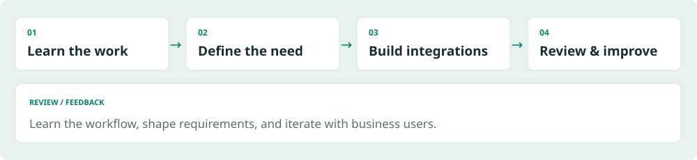

*Explanatory illustration using synthetic data; not a production screen.*

### Start by learning the work
Requirements did not arrive as complete specifications. I learned how operations teams checked plants, how business development assessed sites, and how business support reviewed financial assumptions. The user's actual task shaped the implementation scope.
### Connect implementation to use
My work connects external data collection, normalization, email and attachment processing, database ingestion, business interfaces, and mobile access. I review the result myself and refine it with feedback from business users.
### Roles I am pursuing
For AI-enabled workflow improvement (AX), I emphasize recurring work and where human review belongs. For forward-deployed engineering (FDE), I emphasize translating unclear requests into integrations that work within existing constraints. These are target roles, not current job titles.
### Reading this portfolio
The three main cases cover operations monitoring, reporting automation, and address-based feasibility assessment. All diagrams and example screens are newly created illustrations using synthetic data. Operational status follows the project owner's account; implementation claims follow source and document review, not an independent production re-test.

## 02. From implementation to workflow ownership

**EXPERIENCE** · ERP implementation provided a foundation for internal systems, integrations, and broader responsibility for business workflows.

| Period | Work and responsibility |
|---|---|
| Dec 2023 | Joined an IT services company as a developer |
| Mar 2024–Sep 2025 | ERP systems integration: general affairs modules with DEWS Studio |
| Sep 2025–present | Internal systems, external integrations, and data standards for an energy business |
| From Mar 2026 | Became the sole developer for the relevant internal systems |
| From May 2026 | Expanded into workflow discovery, requirements, planning, technical decisions, and delivery |
| Jul 2026–present | Employed in the energy company's business support department |

### Employment and project dates
The energy systems work began during employment at the previous company and continued after the move. Its start date is not the start date of the current employment. I moved from the budget module during analysis and design to general affairs, developing cafeteria, access-card, research-service, and vehicle-dispatch functions with DEWS Studio.
### Ownership includes collaboration
Sole development responsibility describes the assigned development scope. Business colleagues contributed domain knowledge and feedback. Initial server setup and the platform vendor's installation were separate contributions.

## 03. Translate business context into implementation

**APPROACH** · A working approach that connects discovery, implementation, review, and feedback.

*Explanatory illustration using synthetic data; not a production screen.*

### 1. Learn the workflow and locate friction
I establish where information is checked, where it is entered again, and which exceptions require a person. For pre-fs, domain experts explained the assessment process. For the website, I first clarified the intended audience and message.
### 2. Connect data to the next action
I connect websites, email, files, databases, and business interfaces. The goal is to let someone take the next useful action, not simply to collect data. Inverter-level inspection and visible invoice processing status illustrate this approach.
### 3. Review different kinds of correctness
AI-assisted feature review, SQL and interface reference checks, my own user-oriented review, and business feedback address different concerns. Passing a technical check does not establish that a workflow fits the user's needs.
### Contribution boundary
After initial Linux setup and the vendor's AUDPlatform installation, I developed business functions, external integrations, data standards tooling, and operational improvements. I do not claim the initial server setup, the commercial platform itself, or third-party libraries as my work.

## 04. Eight cases, distinct delivery states

**CASE MAP** · Operational workflows are distinguished from implemented capabilities and ongoing experiments.

| Case | Problem addressed | Confirmed state |
|---|---|---|
| P01 · Monitoring | Fragmented monitoring websites | In use, according to the project owner |
| P02 · Reporting | Repeated email requests and data entry | In use, according to the project owner |
| P03 · pre-fs | An underspecified address-based assessment request | Implementation reviewed; adoption and impact unconfirmed |
| P06 · AUDPlatform workflows | Sales, contracts, orders, meetings, and data consistency | Implemented and improved; adoption did not take hold |
| P04 · Notice discovery | Aggregation, candidate selection, and search | Core implementation; AI search and RAG are pre-adoption |
| P05 · Cost invoices | Visibility of receipt and processing | Functionality implemented; adoption and impact unconfirmed |
| P07 · Website | Audience, message, and internal agreement | Development and internal review ongoing |
| P08 · Explainer video | An unfamiliar production task | Production experience; delivery and reception unconfirmed |

### A shared foundation
P06 covers internal sales, contract, order, and weekly-meeting workflows, supported by interface, SQL, and data standards tooling. The public-notice RAG experiment in P04 is separate from the planned, unstarted OJT and asset-management RAG work.

## 05. Bring fragmented plant status into one view

**P01 / OPERATIONS** · Consolidated a workflow that depended on incoming reports or visiting monitoring sites individually.

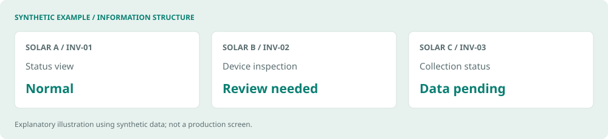

*Explanatory illustration using synthetic data; not a production screen.*

### Problem and existing workflow
Operations and maintenance (O&M) staff had to visit different monitoring websites or wait for reports to discover plant issues. A plant-level issue also required more detail to narrow the investigation to a particular device.
### My responsibility and implementation path
I started by collecting generation data from web-response JSON and HTML. I extended the collection to inverter-level information, built consolidated web and TV views, and connected Telegram for mobile access and notifications.
### What changed for the user
Staff can start from a consolidated view and narrow an investigation to relevant devices rather than assemble the overall picture across separate sources. This supports human investigation; it is not a predictive-maintenance model or an automated root-cause diagnosis system.
### State and evidence
Development and improvements ran from February to August 2026. The project owner reports use by the O&M team. Source review confirmed collection, inverter snapshots, web APIs, and notification paths. Fault reduction and time savings per user have not been measured independently.

## 06. Connect collection, normalization, views, and alerts

**P01 / INTEGRATION** · Transform varied external responses into a shared inspection workflow.

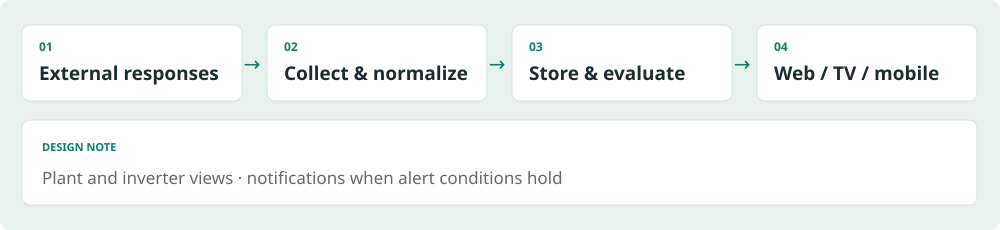

*Explanatory illustration using synthetic data; not a production screen.*

### Data flow
JSON and HTML responses from external monitoring systems are collected, organized by plant and device, and stored. Inverter snapshots feed web, TV, and mobile access. Alert logic then evaluates the relevant conditions. The illustration does not reproduce internal endpoints or production screens.
### Implementation
Reviewed components include Python, requests, BeautifulSoup, Selenium/CDP collection, PostgreSQL storage, and FastAPI query paths. Reading a browser response is described separately from integration with an official public API.
### A meaningful choice
I extended the view beyond plant totals to inverter-level information. When overall generation looks unusual, staff can narrow the set of devices to investigate. This required work on the data's level of detail as well as the interface.
### Purpose of the synthetic screen
The example contains fictional plants and inverters. It illustrates the distinction between normal, review-needed, and data-pending states. It is not a production interface, a measurement record, or evidence of an actual incident.

## 07. Refresh time is not fault confirmation time

**P01 / VERIFICATION** · Separate scheduling, data freshness, condition observation, and notification delivery.

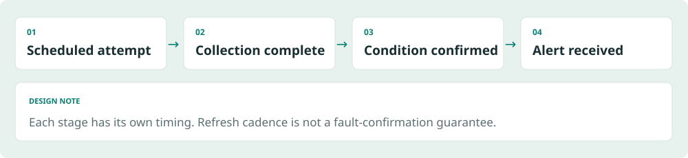

*Explanatory illustration using synthetic data; not a production screen.*

### Overlap control and freshness
The described operating behavior skips the next scheduled collection if the previous run is still active. The scheduling interval and the interval between visible data updates are therefore different. External responses and collection completion affect freshness.
### Condition confirmation and delivery
The source contains observation and confirmation rules by anomaly type, plus snapshot validity conditions. According to the project owner, Telegram delivery follows the collection run when alert conditions hold. Frequent refreshes do not imply that every type of fault can be confirmed within the same interval.
### What is established and what remains
Implementation paths and the operating account were reviewed. The portfolio build did not run the production crawler or reproduce incidents. Stronger verification would separately record collection start and completion, view updates, and notification receipt, then compare them by condition type.
### How I describe the outcome
The established change is consolidated inspection with device-level detail and notifications. Actual latency distributions, missed events, availability commitments, and improvements in response time remain separate measurement questions.

## 08. From reporting requests to ingestion confirmation

**P02 / AUTOMATION** · Connected scheduled email, response files, ingestion, and verification into one workflow.

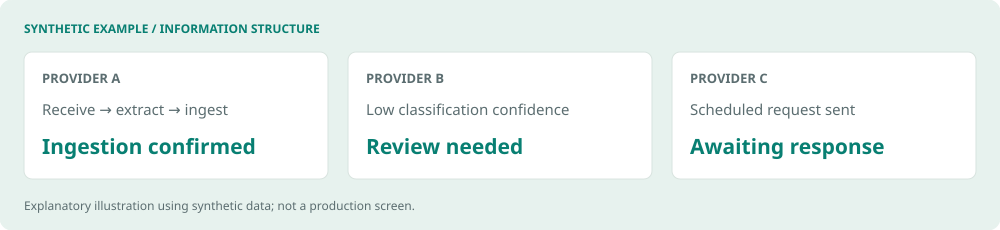

*Explanatory illustration using synthetic data; not a production screen.*

### Recurring work
Staff requested operating data from third-party administrative service providers, waited for replies, and entered and aggregated the received information. Related work included monthly prorating, checks for funding requirements, follow-up on missing responses, and a separate plant list. Some providers replied only after receiving a request.
### My responsibility
I connected monthly request scheduling, email receipt and classification, attachment extraction and validation, and database ingestion on the internal Linux server. Supporting calculation, comparison, and review-state modules were also identified. This does not claim automation of payment authorization.
### A different unit of work
Sending an email or moving a file no longer stands alone as the end of a task: the flow extends to checking whether the received data was ingested. Low-confidence or failed processing can transition to a review state in the implementation.
### State
The project owner reports development in August–September 2026 and operational use by the O&M team. Reported impact is distinguished from independent measurement. Exact provider counts, plant counts, and time savings are excluded from this external draft.

## 09. Make completion verifiable

**P02 / EXCEPTIONS** · Verify the ingestion outcome as well as the classification result.

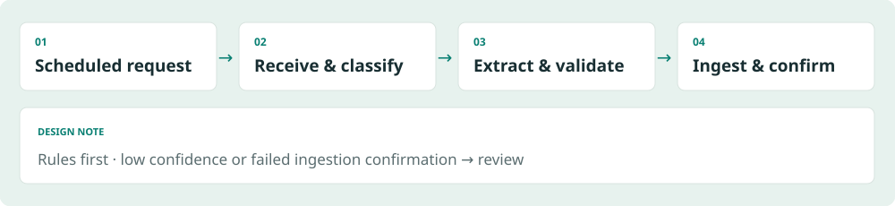

*Explanatory illustration using synthetic data; not a production screen.*

### Processing path
SMTP request → POP3 response → rule-first classification → attachment validation → file watcher → database ingestion → confirmation or review. AI can supplement classification when needed; the claim is not that every email is processed by AI.
### Duplicates and uncertainty
The request path includes a database lock to prevent duplicate sends. Low classification confidence and failed ingestion-receipt checks can move a message into review. The file watcher selects new reporting months for ingestion. These controls address different failure points: sending, classification, and loading.
### Attachments and calculations
Reviewed components include pandas and SQLAlchemy processing, Excel/PDF/image extraction, matching, calculations, and comparisons. The presence of OCR and optional LLM extraction paths does not establish that all of them are enabled in production.
### Verification scope
The reviewed evidence establishes these branches and modules. Actual exception frequency, review volumes, and success rates by file format were not independently measured against production data. The illustration contains no internal business rules or original messages and attachments.

## 10. Describe impact across the whole workflow

**P02 / IMPACT** · Distinguish an automated step from reduced manual work across a monthly process.

### Reported change
The project owner described less manual work across the monthly scope: requests, response data entry, missing-response follow-up, calculations, validation, and exception handling. That account should not be narrowed to email sending or data entry alone.
### Preserve scope without overstating permanence
Reduced manual work in the observed workflow is different from eliminating every future exception or maintenance task. Review paths in the source can coexist with a reported reduction in manual work. Exact impact figures require an observation period, records, and a clear disclosure scope.
### Measurement to add
A follow-up assessment should first fix the business scope and automation coverage, then record time spent on requests, entry, follow-up, calculations, validation, and exceptions before and after adoption. Review counts, failure causes, correction and reprocessing time, and recurring maintenance should be recorded separately.
### Current outcome statement
The implementation connects scheduled requests to parsing and confirmed ingestion, automating recurring work. The project owner's account indicates less manual work across the specified monthly workflow. Values without an observation window and independent records are not presented as headline metrics here.

## 11. “Can we assess a site from its address?”

**P03 / DISCOVERY** · Turned an open-ended request into review steps and data requirements.

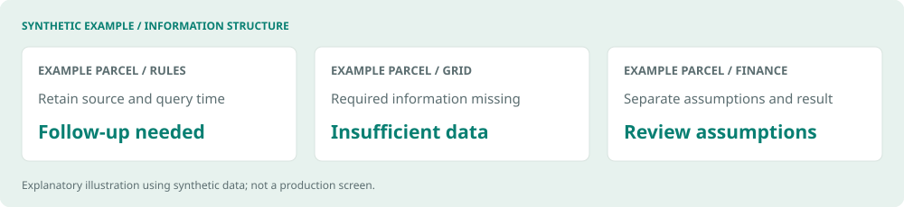

*Explanatory illustration using synthetic data; not a production screen.*

### The initial request
Management asked whether entering an address could support an assessment of a site's business potential. An address search box alone would not define what to review or which evidence the result needed.
### Learning from domain experts
I learned the actual assessment process from a business development colleague. Advice from another specialist and comparisons with similar services helped clarify the review items. I obtained the needed external APIs, implemented and refined the UI, and incorporated financial analysis supplied by business support.
### My role and the collaboration
I translated the request into an implementable scope and connected data sources to the service. Domain knowledge and analysis practices came from business colleagues. The central contribution was turning that expertise into a usable technical workflow.
### Result and state
Source review confirmed an implementation connecting address and parcel information, regulations, grid information, solar resource data, and financial analysis. User counts, adoption dates, review-time savings, and decision outcomes remain unconfirmed. This is preliminary assessment support, not automatic permitting or investment approval.

## 12. Bring different evidence into one review flow

**P03 / EVIDENCE** · Connect spatial, regulatory, grid, solar, and financial information while retaining sources and assumptions.

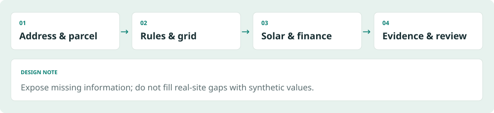

*Explanatory illustration using synthetic data; not a production screen.*

| Review area | Information and role found in the implementation |
|---|---|
| Address / spatial | VWorld, parcel lookup, and spatial processing |
| Regulations | Public ordinance lookup, including the legislation service |
| Grid | KEPCO grid information |
| Solar resource | PVGIS integration |
| Finance | Cash flow, IRR, NPV, and DSCR calculations |
| Records | SQLite snapshots of assumptions and results |

### Implementation structure
Reviewed components include Python, FastAPI, Pydantic, and httpx in the backend; Shapely and pyproj for spatial work; and a Node/JavaScript UI. Provider data differs in meaning and freshness. The documented approach retains sources, query times, and assumptions alongside results.
### A meaningful choice
Missing information should remain visible rather than be replaced with plausible-looking values. The documented policy distinguishes insufficient data from items requiring review and does not fill gaps for real addresses with synthetic values. The fictional parcel screen in this portfolio is explicitly separate explanatory material.

## 13. Make the assessment reviewable

**P03 / JUDGMENT** · Maintain the boundary between calculations and real investment or permitting decisions.

### What the result establishes
IRR, NPV, and DSCR code establishes that financial calculation functionality exists. It does not validate the investment value of a real project. Assumptions affect results, so the evidence, inputs, and outputs need to remain available for review and comparison.
### Documented verification policy
The documentation separates official evidence, observations, estimates, and unknowns, and exposes missing information and review needs. The portfolio build did not call production APIs or independently execute the financial calculations. API access and internal run instructions are not substitutes for evidence of business adoption.
### Next validation step
Adoption evaluation would require business-reviewed samples, missing-information rates, follow-up questions, and comparison with the existing assessment process. A time-saving claim would require before-and-after work of the same scope. This is proposed evaluation work, not a completed experiment.
### Scope of the public example
A fictional parcel and generic review areas illustrate the information structure. Internal financial formulas, actual project sites, and contractual data are not reproduced. Review-needed labels explain the service; they are not investment recommendations.

## 14. Business workflows on AUDPlatform

**P06 / BUSINESS SYSTEMS** · Developed and improved sales opportunities, contracts, projects, order views, and weekly meetings.

### From opportunities to contracts
I developed and improved sales-opportunity management, contract and project registration, and order-target and performance views on AUDPlatform. I clarified the relationships between opportunities, contracts, and projects, and improved consistency between sales status and selection lists when contracts were created or deleted.
### Tracing a revenue-view defect
Another developer built the original revenue-performance feature. I took on a defect where updated voucher records did not reach the revenue views, and traced voucher ingestion, cost and performance calculation, aggregate storage, and screen queries step by step to find the cause.
### Weekly meetings and platform integration
I implemented web-based drafting, saving, versioning, and finalization of departmental meeting material. Section-level editing locks and autosave protect against overwrites. The application is accessed through an AUDPlatform menu using WebContainer, with user, developer, and operations documentation.
### Contribution and evidence
After the vendor installed the platform, I worked on business screens, SQL, data structures, and external integrations. The order and weekly-meeting functions were implemented, but adoption did not take hold because of duplicate-work concerns. I simplified the meeting workflow and UI, wrote manuals, and prioritized monitoring and reporting automation that reduces recurring O&M work. Broader adoption is still ongoing.

## 15. Keep business rules consistent across data and screens

**P06 / QUALITY** · Managed aggregation rules, state transitions, and data standards alongside business interfaces.

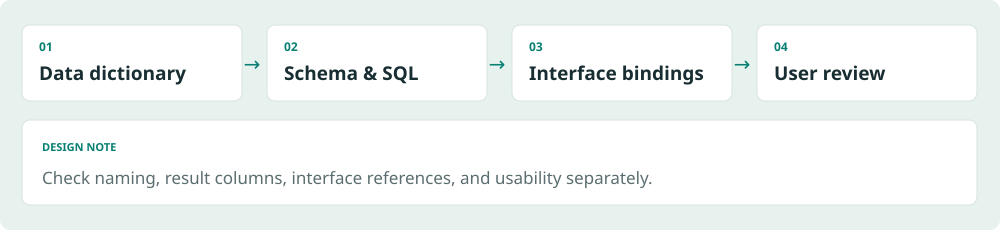

*Explanatory illustration using synthetic data; not a production screen.*

### Business rules and data consistency
I improved how active and deleted contracts affect opportunity status and selection lists. For order reporting, I reviewed exclusion of deleted contracts and inclusion rules for O&M. I checked contract-to-project references and listed missing or inconsistent records that required business decisions.
### Review queries, saves, and interfaces together
I checked the impact of shared SQL changes across reports, result-column bindings, and query and save behavior. Work records include reporting-period comparisons and contract state-transition checks. Developer and business-user review supplemented automated checks.
### Repeated development and data standards
I implemented and used Python tools for screen generation, SQL extraction and checks, binding verification, dictionary lookup, naming checks, and DDL generation. Standard words, terms, domains, and schemas provided a shared foundation for recurring business development work.
### Evidence and impact boundaries
Recorded fixes and checks support implementation claims. Production data was not re-tested during this portfolio edit. Development-speed multipliers, defect reduction, and automated coverage of every domain rule are not claimed.

## 16. Aggregate notices and preserve the original evidence

**P04 / DISCOVERY** · Combine public notice sources so candidates can be inspected alongside the original material.

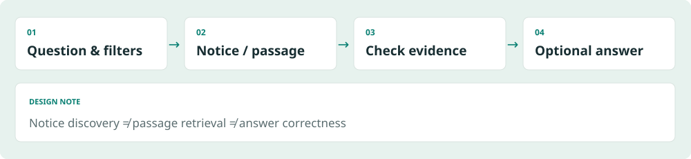

*Explanatory illustration using synthetic data; not a production screen.*

### User problem
Notices spread across sources require repeated discovery and checks for amendments or cancellations. The project owner described a service that aggregates government notices and distinguishes direct and indirect candidates.
### Implemented foundation
Reviewed Python and SQLite components cover official APIs and board collection, separate original and normalized records, candidate classification, duplicate prevention, amendment and cancellation handling, retries, and checkpoints. CSV/XLSX export and an AUD interface connection are also present.
### Meaning of candidate selection
Direct, indirect, and broad candidates narrow the search space. Rule-based classification is not described as an LLM making a business decision. Relevance still requires checking the original notice against the business context.
### State and limits
Core aggregation and discovery functionality was reviewed, but adoption dates and business usage scope remain unconfirmed. No claim is made about reduced search time or increased contract wins. Natural-language search and RAG are separate development and experimentation work.

## 17. From questions to search conditions and evidence

**P04 / AI SEARCH** · Separate query interpretation, passage retrieval, and optional answer generation.

*Explanatory illustration using synthetic data; not a production screen.*

### Natural-language search
The implementation transforms questions into structured topics and filters, then combines keyword and embedding-based results. Its central function is query interpretation, not arbitrary SQL generation or a final business decision.
### Local RAG experiment
A separate experiment uses FastEmbed/ONNX local embeddings to retrieve notice and attachment passages and compare keyword, vector, and hybrid search. Optional generation from retrieved evidence and citation checks are implemented.
### Quality differs by stage
Finding the relevant notice, retrieving the necessary attachment passage, and producing a correct answer from that evidence are distinct tasks. Verifying the presence of citations does not establish semantic correctness.
### Current state
The project owner confirms development and experimentation before business adoption. Connection or deployment records are not evidence of operational productivity improvements. This work is also separate from the planned OJT and asset-management RAG project.

## 18. Evaluate notice discovery and evidence retrieval separately

**P04 / EVALUATION** · Finding the right notice does not necessarily provide the evidence needed to answer.

### Evaluation in the project records
The search evaluation distinguishes retrieving the correct notice among top results from finding the required attachment passage. It records limitations in attachment evidence retrieval. Small samples measuring different tasks should not be combined into a single system accuracy figure.
### Limits of the evaluation conditions
Some natural-language search checks explicitly ran without an API key, excluding actual model response quality and the complete vector path. Experiment scale and scores are document records; the portfolio build did not query the database or rerun the evaluation.
### The judgment this case demonstrates
The useful distinction is between retrieving evidence, generating text, and establishing what has actually been verified. A generation component alone does not close gaps in passage retrieval. If the evidence is missing, evaluation and improvement must address that stage first.
### Next improvement
Future work should expand business-question samples and maintain separate notice- and passage-level references. Citation presence, consistency with evidence, and correct interpretation of conditions each require checks. These remain follow-up directions, not completed validation or business outcomes.

## 19. Make invoice receipt and processing visible

**P05 / VISIBILITY** · Move invoice follow-up from personal memory into visible workflow states.

### Problem
Staff needed to check whether electricity and telecommunications invoices had arrived and whether follow-up was complete. The project owner mentioned previous additional charges, but the exact charge type, count, and causes have not been established.
### My contribution
I connected receipt to a business-system list and processing status. Reviewed evidence includes recording email-analysis results by invoice and plant, and documentation of receipt, voucher-status visibility, and manual review.
### Choice and workflow change
The interface exposes items that need attention so omissions can be noticed. Receiving an email is distinct from completing the business task. This is a visibility improvement; it is not a claim that journal posting, voucher issuance, or payment was automated.
### Result and further evidence
The implemented capability and user account support a case about connected receipt and processing status. Adoption scope, actual discoveries of unprocessed items, and before-and-after omission rates remain to be confirmed. No savings figure or zero-incident claim is presented.

## 20. Own the website’s purpose and internal alignment

**P07 / ALIGNMENT** · Clarified the audience, message, and information structure alongside implementation.

### Background and proposal
After seeing a planned external website quote, I proposed building the site internally, with support for AI-tool costs. A proposed replacement for outsourced work is not yet a realized saving, so this case emphasizes the proposal and delivery responsibility.
### My scope
Alongside frontend and backend implementation, I defined the target audience, storyline, hero message, and information architecture. My account also includes collecting internal input and helping move decisions forward.
### Work beyond implementation
Collecting opinions does not by itself establish a design direction. Clarifying who the site serves and what it should communicate helps turn internal agreement into an artifact. This experience extends beyond implementing a fixed screen specification.
### State and evidence
The confirmed state is ongoing development and internal review. The source is in a separate local environment and was not examined in this review. Publication, final delivery, realized cost savings, and visitor outcomes are not claimed. The planned company domain is not used for this personal portfolio.

## 21. Build a workflow for an unfamiliar video task

**P08 / ADAPTATION** · Tested tools and replaced a production step that was difficult to control.

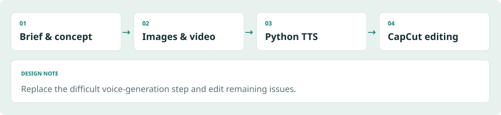

*Explanatory illustration using synthetic data; not a production screen.*

### Request and constraints
I was asked to turn a presentation about solar generation and permitting procedures into an explanatory video. I had no prior video-production experience and tested available free tiers because subscribing to every paid tool was not practical.
### Production sequence
I explored methods with ChatGPT and Gemini, created concept images with ChatGPT, generated video with Gemini, and edited it in CapCut. The work involved connecting tools around the intended output.
### Replacing a difficult step
Voice-generation errors in Gemini were difficult to control, so I switched to a Python text-to-speech library for audio. Remaining issues were corrected in CapCut. This is a production workflow, not the development of a custom voice or video model.
### Result and limits
The case demonstrates learning an unfamiliar task and replacing a problematic step. The exact TTS library, video duration, delivery status, and audience response remain unconfirmed. A newly drawn process diagram is provided instead of the original presentation or video.

## 22. Distinguish AI assistance from human responsibility

**AI PRACTICE** · Separate development assistance, system capabilities, content production, and future plans.

| Use | Actual example | Review boundary |
|---|---|---|
| Development assistance | Gemini, Cursor, ChatGPT, and Claude support implementation and review | Developer and business users review the final result |
| Workflow capability | Optional AI assistance for email classification | Rules first; not every email goes through AI |
| Search experimentation | Query structuring, embeddings, optional evidence-based generation | Before adoption; retrieval and generation evaluated separately |
| Content production | Images, video, TTS, and editing | Use of production tools, not model development |
| Future direction | OJT and asset-management RAG | Planned, not started |

### Human responsibility
Using AI does not replace the responsibility to understand requirements, choose the implementation scope, or inspect the final result. Technical checks and user review ask different questions.
### Precise technical claims
Crawling, rule-based classification, calculation, and scheduling are not inherently AI features. Conversely, actual AI paths in email assistance and search experiments are distinct from AI-assisted coding. This portfolio emphasizes business problem definition and system integration rather than model research.

## 23. Ground technical capabilities in actual cases

**CAPABILITIES** · Each capability is connected to an implemented workflow and its evidence boundary.

| Capability | Connected technology and work | Cases |
|---|---|---|
| Collection / integration | Python, requests, BeautifulSoup, Selenium/CDP, JSON/HTML | P01, P04 |
| Services / APIs | FastAPI, Pydantic, httpx, Node/JavaScript | P01, P03 |
| Storage / processing | PostgreSQL, SQLite, pandas, SQLAlchemy | P01–P04 |
| Messages / files | SMTP/POP3, Excel/PDF processing, file watchers, review states | P02, P05 |
| Spatial / financial integration | Shapely, pyproj, external data, cash flow / IRR / NPV / DSCR | P03 |
| Development / data standards | Python tools, SQL / binding / naming checks, dictionaries | P06 |
| AI search experiments | Query structuring, embeddings, FastEmbed/ONNX, evidence retrieval and citation checks | P04 |
| Discovery / collaboration | Domain learning, information structure, stakeholder input, feedback | P03, P07 |

### How to read the technology choices
The focus is each tool's role in the workflow. Reviewed source and dependencies are paired with the account of personal contribution; using a library is not presented as building that product. Unverified skill ratings and proficiency scores are omitted.

## 24. Continue with measurement and reusable business knowledge

**NEXT** · Measure implemented workflows and use accumulated business knowledge to guide the next steps.

### Priorities for improvement
Monitoring needs separate measurements for freshness, condition confirmation, and notification latency. Reporting needs records that distinguish the monthly task scope from maintenance. pre-fs needs business-reviewed samples and confirmed adoption scope. Notice search needs distinct improvements in attachment evidence retrieval and generated-answer evaluation.
### Reusable business knowledge and plans
The weekly-meeting workflow and AUDPlatform integration in P06 provide a foundation for preserving business knowledge; adoption impact remains unconfirmed. I plan to explore OJT and asset-management RAG using accumulated processes, documents, and data. That RAG work has not started.
### Contribution to AX work
I can identify recurring tasks and business bottlenecks, define automation boundaries, and retain appropriate human review. Relevant experience includes reporting automation, monitoring, development and data standards tooling, and search experiments.
### Contribution to FDE work
I can clarify ambiguous requests with users and connect implementation and verification within external-data and existing-system constraints. Monitoring, pre-fs, and reporting integration demonstrate that approach.
### Working principle
I learn the work, connect people and technology, and inspect the result myself. The objective is a useful, explainable outcome that people can actually work with.

---

김민기 · Kim Mingi · 2026.09 · Generalized experience and newly created synthetic illustrations.

[PDF](../exports/portfolio.en.full.pdf) · [PPTX](../exports/portfolio.en.full.pptx) · [DOCX](../exports/portfolio.en.full.docx) · [Web](../web/en.full.html)

[GitHub](https://github.com/laekhole)
