# 모호한 요구를 실제로 쓰이는 시스템으로 만드는 엔지니어

현업의 업무를 직접 배우고 병목을 찾아, 필요한 사람과 기술을 연결해 해결합니다. 에너지 분야의 O&M 모니터링, 실적 처리 자동화, 사업성 사전 검토와 AUDPlatform 기반 영업·수주·주간회의 업무 개발을 맡아 왔습니다.

## 전체 목차

- [01 · 모호한 요구를 실제로 쓰이는 시스템으로 만드는 엔지니어](#profile)
- [02 · 구현 담당에서 업무 문제의 해결로](#career)
- [03 · 현업의 언어를 구현과 검증으로](#method)
- [04 · 8개 사례, 서로 다른 완료 상태](#cases)
- [05 · 흩어진 발전소 상태를 한 화면으로](#p01)
- [06 · 수집·정규화·표시·알림을 연결](#p01-architecture)
- [07 · 갱신과 이상 확정은 다른 시간입니다](#p01-validation)
- [08 · 실적 요청부터 적재 확인까지](#p02)
- [09 · 자동 처리의 끝에 확인을 남깁니다](#p02-architecture)
- [10 · 업무 전체의 변화를 설명합니다](#p02-outcome)
- [11 · “주소로 사업성을 볼 수 있을까?”](#p03)
- [12 · 서로 다른 근거를 같은 검토 흐름으로](#p03-architecture)
- [13 · 계산 결과보다 검토 가능한 근거](#p03-validation)
- [14 · 영업·수주·회의를 업무 시스템으로](#p06)
- [15 · 업무 규칙을 데이터와 화면에 함께 반영](#p06-validation)
- [16 · 공고를 모으고 원문 근거로 좁히기](#p04)
- [17 · 질문을 검색 조건으로, 근거를 답변으로](#p04-ai)
- [18 · 공고 발견과 근거 회수를 따로 평가](#p04-evaluation)
- [19 · 청구서의 도착과 처리를 보이게](#p05)
- [20 · 홈페이지의 목적부터 내부 합의까지](#p07)
- [21 · 낯선 영상 과제를 제작 흐름으로](#p08)
- [22 · AI가 하는 일과 사람이 책임질 일](#ai-practice)
- [23 · 기술은 사례와 함께 증명합니다](#skills)
- [24 · 측정과 업무 자산화로 이어갑니다](#next)

## 01. 모호한 요구를 실제로 쓰이는 시스템으로 만드는 엔지니어

**PROFILE** · 현업의 업무를 직접 배우고 병목을 찾아, 필요한 사람과 기술을 연결해 해결합니다. 에너지 분야의 O&M 모니터링, 실적 처리 자동화, 사업성 사전 검토와 AUDPlatform 기반 영업·수주·주간회의 업무 개발을 맡아 왔습니다.

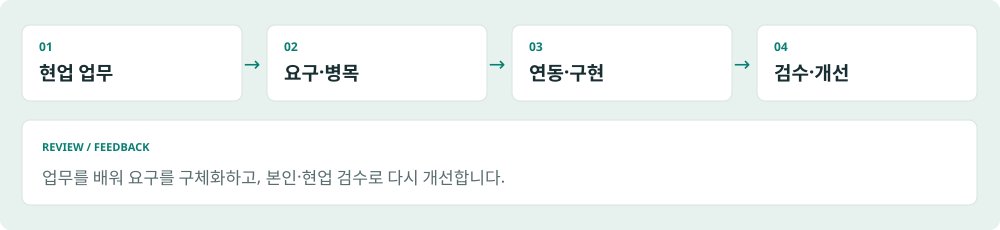

*합성 데이터로 재구성한 설명용 예시 · 실제 운영 화면이 아닙니다.*

### 업무를 배우는 데서 시작합니다
처음부터 완성된 요구사항이 주어지지는 않았습니다. 발전소 운영 담당자의 확인 방식, 사업개발 담당자의 검토 순서, 경영지원의 수익성 분석을 배우며 구현할 범위를 구체화했습니다. 기술 선택의 출발점은 실제 사용자가 해야 하는 일입니다.
### 연동에서 운영까지 연결합니다
외부 데이터 수집과 정규화, 메일·첨부 처리, 데이터베이스 적재, 업무 화면과 모바일 조회를 연결했습니다. 기능을 만든 뒤에는 본인 검수와 현업 피드백으로 결과를 확인하고 개선했습니다.
### 지원하는 역할
AX에서는 반복 업무를 줄이고 사람의 검토를 남기는 판단을, FDE에서는 불명확한 요구와 기존 시스템 제약을 실제 구현으로 연결하는 역량을 보여드립니다. AX·FDE는 지원 방향이며 현재 공식 직함을 뜻하지 않습니다.
### 이 포트폴리오의 읽는 법
대표 사례는 O&M 관제, 실적 자동화, 주소 기반 예비 사업성 검토입니다. 도식과 예시 화면은 합성 자료로 새로 구성했습니다. 운영 상태는 사용자 설명, 구현 범위는 확인된 소스·문서에 근거하며 독립적인 운영 재측정과 구분합니다.

## 02. 구현 담당에서 업무 문제의 해결로

**EXPERIENCE** · ERP 구축 경험을 바탕으로 사내 시스템과 외부 연동, 업무 개선의 책임 범위를 넓혔습니다.

| 시기 | 업무와 역할 |
|---|---|
| 2023.12 | IT 서비스 기업에 개발자로 입사 |
| 2024.03–2025.09 | ERP 구축 SI · DEWS Studio 기반 총무 모듈 개발 |
| 2025.09–현재 | 에너지 기업의 사내 시스템 도입·개발, 외부 연동, 데이터 표준 관리 |
| 2026.03 이후 | 해당 사내 시스템의 개발을 혼자 담당 |
| 2026.05 이후 | 현업 업무 파악, 프로세스 개선, 요구·일정·기술 판단과 개발 책임으로 역할 확대 |
| 2026.07–현재 | 에너지 기업 경영지원부 소속으로 재직 |

### 소속 기간과 프로젝트 기간
에너지 기업의 시스템 작업은 이전 회사 소속일 때 시작해 현재 소속으로 이어집니다. 프로젝트 시작을 현재 회사 입사 시점과 동일하게 보지 않습니다. ERP에서는 예산 모듈에 배정됐다가 분석·설계 단계에서 총무 모듈로 이동해 구내식당·출입증·연구관리(용역)·배차관리를 DEWS Studio로 개발했습니다.
### 협업을 포함한 책임
개발을 혼자 맡았다는 설명은 담당 개발 범위에 관한 것입니다. 현업은 업무 지식과 피드백을 제공했고, 초기 서버 세팅과 제품 설치에는 별도 기여가 있었습니다.

## 03. 현업의 언어를 구현과 검증으로

**APPROACH** · 업무 파악부터 피드백까지 이어지는 공통 작업 방식입니다.

*합성 데이터로 재구성한 설명용 예시 · 실제 운영 화면이 아닙니다.*

### 1. 업무를 배우고 병목을 정리
어떤 정보를 어디에서 확인하는지, 같은 내용을 다시 입력하는지, 어떤 예외에서 담당자가 개입하는지 파악합니다. pre-fs에서는 현업 전문가에게 분석 프로세스를 배웠고, 홈페이지에서는 대상 독자와 전달할 메시지를 먼저 정리했습니다.
### 2. 데이터와 사용 흐름을 연결
별도 사이트와 메일, 파일, DB, 업무 화면 사이를 연결합니다. 데이터가 모였다는 사실보다 담당자가 다음에 무엇을 확인하고 처리할 수 있는지가 중요합니다. 인버터 단위 조회와 청구 처리 상태의 목록화가 그 예입니다.
### 3. 구현 결과를 나누어 확인
AI 보조 기능 검토, SQL·화면 참조 점검, 본인의 사용자 관점 검수, 현업의 피드백을 구분합니다. 자동 점검 통과만으로 실제 업무에 맞는다고 결론 내리지 않습니다.
### 본인의 기여 범위
초기 Linux 세팅과 공급사의 AUDPlatform 설치 이후 업무 기능 개발, 외부 연동, 데이터 표준 관리와 운영 개선을 수행했습니다. Linux 최초 구축, 상용 제품 자체 개발, 제3자 라이브러리 제작은 본인 실적으로 포함하지 않습니다.

## 04. 8개 사례, 서로 다른 완료 상태

**CASE MAP** · 운영 중인 업무와 구현·실험 중인 작업을 구분합니다.

| 사례 | 해결한 문제 | 확인된 상태 |
|---|---|---|
| P01 · O&M 관제 | 여러 모니터링 사이트의 분산 조회 | 운영 중이라는 사용자 설명 |
| P02 · 실적 자동화 | 메일 요청·수신·입력의 반복 | 운영 중이라는 사용자 설명 |
| P03 · pre-fs | 주소 기반 검토 요청의 구체화 | 구현 확인, 현업 도입·효과 미확인 |
| P06 · AUDPlatform 업무 시스템 | 영업·수주·회의와 데이터 정합성 | 구현·개선; 현업 도입 미정착 |
| P04 · 공고 탐색 | 공고 집계·후보 분류·검색 | 기본 기능 구현; AI 검색·RAG는 현업 사용 전 |
| P05 · 비용 청구 | 청구 수신·처리 상태의 가시성 | 기능 구현; 도입 범위·효과 미확인 |
| P07 · 홈페이지 | 목적·대상·내부 의견의 구체화 | 개발·내부 검토 중 |
| P08 · 설명 영상 | 낯선 영상 제작 과제 | 제작 경험; 납품·반응 미확인 |

### 공통 기반
P06은 영업·수주·주간회의 업무를 다루는 사내 시스템 개발 경험입니다. 화면·SQL·표준 사전 도구는 이 업무 기능들을 개발하고 점검하는 기반입니다. P04의 공고 RAG 실험과 향후 OJT·자산관리 RAG 계획은 별개입니다.

## 05. 흩어진 발전소 상태를 한 화면으로

**P01 / OPERATIONS** · 연락을 기다리거나 사이트를 하나씩 방문하던 확인 업무를 통합했습니다.

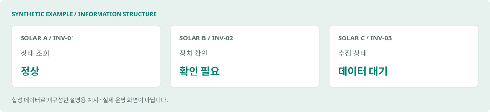

*합성 데이터로 재구성한 설명용 예시 · 실제 운영 화면이 아닙니다.*

### 문제와 기존 사용자 흐름
발전소 운영·유지보수(O&M) 담당자는 이상 여부를 파악하려고 서로 다른 모니터링 사이트를 찾아다녀야 했습니다. 발전소 수준에서 문제가 보이더라도 어느 장치에서 발생했는지 확인하려면 더 자세한 정보가 필요했습니다.
### 본인의 책임과 확장 과정
웹 응답 JSON과 HTML에서 발전 데이터를 수집하는 작업부터 시작했습니다. 이후 인버터 단위 정보를 추가해 문제가 있는 구성부를 살펴볼 수 있도록 확장했습니다. 집계 웹과 TV 관제 화면을 만들고 텔레그램을 연결해 모바일 조회와 알림으로 이어지게 했습니다.
### 변화한 업무
개별 출처를 오가며 전체 상황을 조합하는 대신 통합 화면에서 상태를 보고 필요한 장치로 확인 범위를 좁힐 수 있습니다. 사람이 원인을 확정하는 업무를 지원하며 자동 진단이나 예지보전 모델을 구축했다는 의미는 아닙니다.
### 상태와 근거
2026.02–2026.08 개발·개선, O&M 팀 운영 중이라는 사용자 설명이 있습니다. 수집·인버터 스냅샷·웹 API·알림 경로의 구현을 확인했습니다. 장애 감소율과 실제 사용자별 시간 절감은 측정하지 않았습니다.

## 06. 수집·정규화·표시·알림을 연결

**P01 / INTEGRATION** · 외부 데이터의 형태를 공통 조회 흐름으로 바꿨습니다.

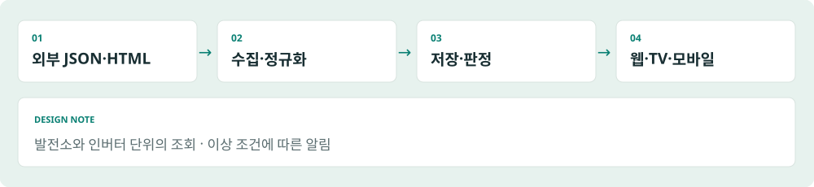

*합성 데이터로 재구성한 설명용 예시 · 실제 운영 화면이 아닙니다.*

### 데이터 흐름
외부 모니터링의 JSON·HTML 응답을 수집하고, 발전소와 장치 기준으로 정리해 저장합니다. 인버터 스냅샷을 거쳐 웹·TV 화면과 모바일 조회에 연결하고, 이상 판정 조건에 따라 알림을 제공합니다. 포트폴리오 도식은 실제 내부 주소나 운영 화면을 재현하지 않습니다.
### 기술 구성
Python, requests, BeautifulSoup, Selenium/CDP를 이용한 수집 구현, PostgreSQL 저장, FastAPI 기반 조회 경로가 확인되었습니다. 브라우저 응답에서 데이터를 읽는 수집과 정식 공개 API 연동은 같은 것으로 표현하지 않습니다.
### 중요한 선택
발전소 합계만 보여주는 데서 멈추지 않고 인버터 정보로 확장했습니다. 전체 발전량의 이상을 봤을 때 확인할 대상 범위를 줄이는 선택입니다. 화면을 만드는 것과 수집 데이터의 단위를 정리하는 일이 함께 필요했습니다.
### 합성 화면의 목적
예시에는 가상 발전소와 인버터만 사용합니다. 정상·확인 필요·데이터 대기 상태를 구별하는 정보 구조를 설명하기 위한 재구성이며 실제 UI, 운영값, 장애 발생 기록이 아닙니다.

## 07. 갱신과 이상 확정은 다른 시간입니다

**P01 / VERIFICATION** · 스케줄 실행, 데이터 갱신, 이상 관찰, 알림 전송을 구분합니다.

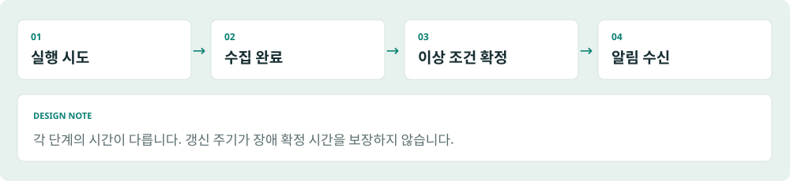

*합성 데이터로 재구성한 설명용 예시 · 실제 운영 화면이 아닙니다.*

### 중복 실행과 갱신
이전 수집이 진행 중이면 다음 실행을 건너뛰는 운영 방식이 사용자 설명으로 확인되었습니다. 실행 시도 간격과 화면에 새 데이터가 나타나는 간격은 같지 않습니다. 외부 응답과 수집 완료 시점의 영향을 받기 때문입니다.
### 이상 판정과 전송
소스에는 이상 종류에 따른 관찰·확정 조건과 스냅샷 유효 시간 기준이 있습니다. 조건이 성립하면 수집 종료 후 텔레그램으로 발송한다는 운영 설명을 확인했습니다. 빠른 데이터 갱신만으로 모든 장애를 같은 시간 안에 확정한다고 말할 수는 없습니다.
### 확인한 것과 남은 것
구현 경로와 사용자 설명을 확인했으며 이번 포트폴리오 제작에서 운영 크롤러를 실행하거나 장애를 재현하지 않았습니다. 결과 검증을 더 강화하려면 수집 시작·완료·화면 반영·알림 수신 시점을 따로 기록하고 조건별로 비교해야 합니다.
### 결과의 표현
분산 조회를 통합하고 장치 단위 확인과 알림을 연결한 변화가 현재 설명할 수 있는 결과입니다. 실제 지연 분포, 누락 비율, 가용성 SLA와 장애 대응 시간 개선은 추가 측정 대상입니다.

## 08. 실적 요청부터 적재 확인까지

**P02 / AUTOMATION** · 정기 메일, 회신 파일, 입력·검증을 하나의 처리 흐름으로 연결했습니다.

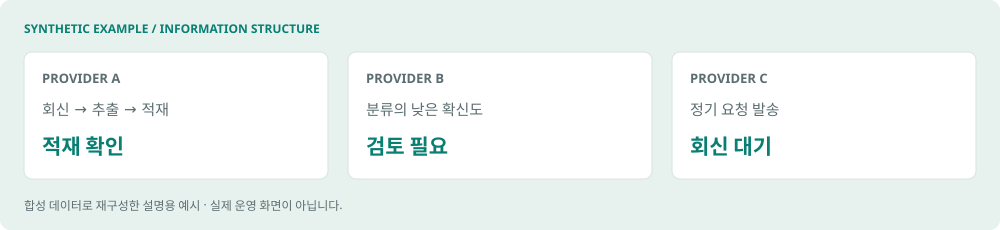

*합성 데이터로 재구성한 설명용 예시 · 실제 운영 화면이 아닙니다.*

### 반복되던 업무
담당자는 사무수탁사에 실적을 요청하고 회신을 기다린 뒤 수신 자료를 입력·집계했습니다. 월별 일할 계산, 자금보충 여부 판단을 위한 검증, 미회신 추적과 별도 발전소 목록 관리도 연결된 업무였습니다. 일부 제공자는 요청해야 회신하는 특성이 있었습니다.
### 본인의 책임
월별 일정에 따른 요청 발송, 메일 수신과 분류, 첨부의 추출·검증, DB 적재를 사내 Linux 환경에서 연결했습니다. 관련 계산·비교·검토 상태까지 이어지는 모듈이 확인되었습니다. 자금 지급 승인 자체를 자동화했다는 의미는 아닙니다.
### 바뀐 작업 단위
메일을 보냈는지 확인하는 작업과 파일을 옮기는 작업이 각각 끝나는 대신, 수신 자료가 적재되었는지 확인하는 흐름으로 이어집니다. 처리 실패나 낮은 확신도는 별도 검토 상태로 분기하는 구현이 있습니다.
### 상태
2026.08–2026.09 개발, O&M 팀 운영 중이라는 사용자 설명이 있습니다. 운영 효과는 사용자 진술과 독립 측정을 구분하며, 정확한 조직 수·발전소 수·절감 시간은 외부본에 포함하지 않았습니다.

## 09. 자동 처리의 끝에 확인을 남깁니다

**P02 / EXCEPTIONS** · 분류 결과뿐 아니라 실제 적재 결과를 확인하는 구조입니다.

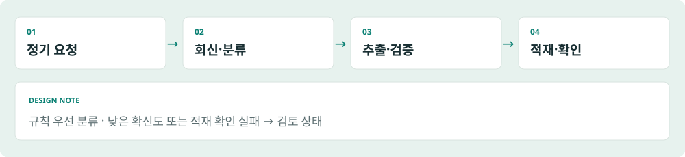

*합성 데이터로 재구성한 설명용 예시 · 실제 운영 화면이 아닙니다.*

### 처리 경로
SMTP 요청 → POP3 회신 → 규칙 우선 분류 → 첨부 검증 → 파일 워처 → DB 적재 → 적재 확인·검토 상태로 연결됩니다. 필요한 경우 AI가 분류를 보완하는 경로가 있으며 모든 메일을 AI가 처리한다고 설명하지 않습니다.
### 중복과 불확실성
요청 발송에는 DB 잠금으로 중복 발송을 방지하는 구현이 있습니다. 메일 처리에는 낮은 확신도와 적재 영수증 확인 실패를 검토로 전환하는 경로가 있습니다. 파일 워처는 신규 월을 선별해 적재합니다. 각각 발송·분류·적재의 다른 실패 가능성을 다룹니다.
### 첨부와 계산
pandas와 SQLAlchemy를 통한 데이터 처리, Excel·PDF·이미지 추출, 매칭과 계산·비교 구현이 확인되었습니다. OCR과 선택적 LLM 추출 경로의 존재가 모두 운영에서 활성화되어 있다는 뜻은 아닙니다.
### 검증의 범위
확인된 것은 이 분기와 모듈의 존재입니다. 실제 예외 발생률, 검토 건수, 각 포맷별 성공률은 운영 데이터로 재측정하지 않았습니다. 설명용 도식은 내부 업무 규칙이나 원본 메일·첨부를 포함하지 않습니다.

## 10. 업무 전체의 변화를 설명합니다

**P02 / IMPACT** · 한 단계의 자동화와 월간 업무 전체의 수작업 감소를 구분합니다.

### 사용자가 설명한 변화
사용자는 요청·회신 데이터 입력뿐 아니라 미회신 추적, 계산, 검증, 예외 처리를 포함한 대상 월간 업무의 수작업이 줄었다고 설명했습니다. 이를 단순한 메일 발송 기능이나 입력 단계만의 효과로 축소하지 않습니다.
### 범위를 유지하면서 과장을 피하기
대상 업무의 수작업 감소와 모든 미래 예외·유지보수의 소멸은 다릅니다. 소스에 검토 경로가 있다는 사실과 관측한 업무에서 수작업이 줄었다는 설명은 함께 성립할 수 있습니다. 정확한 성과 수치는 관측 기간·기록과 공개 범위를 갖춰야 합니다.
### 남겨야 할 측정 기준
대상 업무와 자동화 적용 범위를 먼저 고정하고, 도입 전후에 요청·입력·추적·계산·검증·예외에 쓴 시간을 각각 기록하는 것이 후속 과제입니다. 검토 건수와 원인, 수정·재처리 시간, 정기 유지보수 시간은 구분해 관리할 필요가 있습니다.
### 현재 결과의 표현
정기 요청에서 회신 파싱·적재 확인까지 연결하여 반복 업무를 자동화했고, 사용자 설명상 대상 월간 업무의 수작업을 줄였습니다. 관측 기간과 독립 측정 기록이 없는 값은 이 공개용 초안의 대표 숫자로 사용하지 않습니다.

## 11. “주소로 사업성을 볼 수 있을까?”

**P03 / DISCOVERY** · 모호한 요청을 현업의 검토 순서와 데이터 요구로 바꿨습니다.

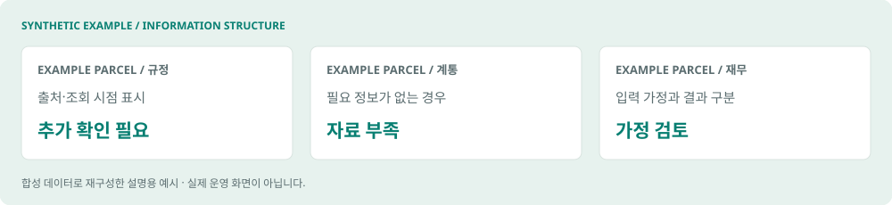

*합성 데이터로 재구성한 설명용 예시 · 실제 운영 화면이 아닙니다.*

### 출발한 요청
경영진은 주소를 입력하면 해당 필지의 사업성을 검토할 수 있는지 물었습니다. 주소 검색 화면을 만드는 것만으로는 어떤 조건을 검토하고 어떤 근거를 제시해야 하는지 정해지지 않았습니다.
### 현업에게 배운 과정
사업개발 담당자에게 실제 분석 프로세스를 배웠습니다. 다른 사업개발 전문가의 조언과 유사 서비스 벤치마킹으로 검토 항목을 정리했습니다. 필요한 외부 API를 확보하고 구현·UI 개선을 진행했으며, 경영지원 담당자의 수익성 분석을 추가했습니다.
### 본인의 책임과 협업
본인은 요구를 구체화하고 데이터 연동과 서비스 구현을 연결했습니다. 분석 순서와 업무 지식은 현업의 기여입니다. 다른 사람의 전문 지식을 받아 기술적인 검토 흐름으로 만드는 과정이 이 사례의 핵심입니다.
### 결과와 상태
주소·필지, 규정, 계통, 일사량과 수익성 정보를 연결한 예비 검토 서비스의 구현이 확인되었습니다. 실제 사용자 수, 도입일, 검토시간 감소와 의사결정 성과는 확인되지 않았습니다. 인허가나 투자를 확정하는 자동 판정 서비스로 표현하지 않습니다.

## 12. 서로 다른 근거를 같은 검토 흐름으로

**P03 / EVIDENCE** · 공간·규정·계통·일사량·재무 정보를 연결하되 출처와 가정을 남깁니다.

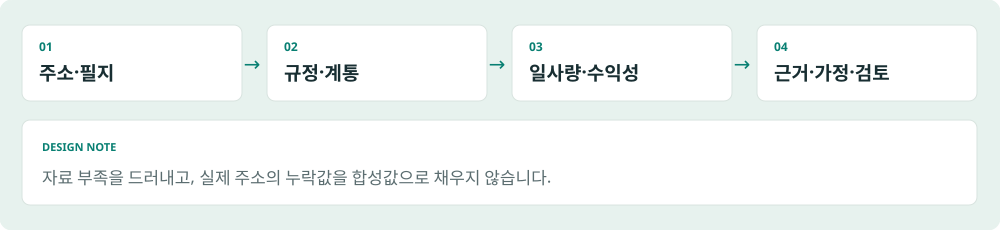

*합성 데이터로 재구성한 설명용 예시 · 실제 운영 화면이 아닙니다.*

| 검토 영역 | 구현에서 확인한 정보와 역할 |
|---|---|
| 주소·공간 | VWorld, 필지 조회와 공간 처리 |
| 규정 | 법제처 조례 등 공개 규정 조회 |
| 계통 | 한전 계통 정보 조회 |
| 일사량 | PVGIS 데이터 연동 |
| 재무 | 현금흐름, IRR·NPV·DSCR 계산 구현 |
| 기록 | 분석 가정과 결과를 SQLite snapshot으로 저장 |

### 구현 구조
Python·FastAPI·Pydantic·httpx 백엔드, Shapely·pyproj 공간 처리, Node/JavaScript UI 구조를 확인했습니다. 공급자별 데이터는 같은 의미나 갱신 주기를 갖지 않으므로 결과와 함께 자료 출처·조회 시점·가정을 관리하는 정책이 문서에 있습니다.
### 중요한 선택
정보가 없을 때 결과를 그럴듯하게 완성하는 대신 자료 부족과 검토 필요 상태를 구분합니다. 실제 주소의 누락값을 합성값으로 채우지 않는 정책을 따릅니다. 포트폴리오의 가상 필지 화면은 설명 자료로 명확히 분리합니다.

## 13. 계산 결과보다 검토 가능한 근거

**P03 / JUDGMENT** · 수익성 계산과 실제 투자·인허가 판단 사이의 경계를 유지합니다.

### 설명해야 하는 결과
IRR·NPV·DSCR 계산 코드의 존재는 수익성 계산 기능의 근거입니다. 실제 사업의 투자 가치를 검증했다는 뜻은 아닙니다. 가정이 바뀌면 결과가 달라지므로 조회 근거, 분석 입력과 결과를 함께 보존하고 비교할 수 있어야 합니다.
### 확인된 검증 정책
문서는 공식 근거·관찰·추정·미확인을 구분하고 자료 부족과 검토 필요 상태를 드러냅니다. 포트폴리오 제작에서는 운영 API 호출이나 재무 계산의 독립 실행 검증을 하지 않았습니다. API 키 발급이나 내부 실행 문서를 현업 도입 성과로 대신하지 않습니다.
### 다음 검증
실제 도입 평가에는 현업이 검토한 표본, 필수 정보 누락률, 추가 확인 항목, 기존 검토 방식과의 결과 비교가 필요합니다. 검토시간 감소를 주장하려면 같은 범위의 업무를 전후로 비교해야 합니다. 이는 향후 검증 설계이며 이미 수행한 실험으로 제시하지 않습니다.
### 공개 예시의 범위
가상 필지와 일반적인 검토 항목으로 서비스의 정보 구조를 설명합니다. 내부 수익성 산식이나 실제 사업 후보지·계약 정보는 재현하지 않습니다. 예시의 검토 필요 표시는 기능 설명이며 투자 권고가 아닙니다.

## 14. 영업·수주·회의를 업무 시스템으로

**P06 / BUSINESS SYSTEMS** · 사업기회부터 계약·프로젝트·수주 실적 조회·주간회의까지 구현·개선했습니다.

### 영업에서 수주로 이어지는 흐름
AUDPlatform 기반 사내 시스템에서 사업기회 관리, 계약·프로젝트 등록, 수주 목표·실적 조회를 개발·개선했습니다. 사업기회가 계약과 프로젝트로 이어지는 관계를 정리하고, 계약 등록·삭제에 따른 영업 진행상태와 조회 목록의 일관성을 보완했습니다.
### 매출 실적 반영 오류 추적
매출 실적 기능은 다른 담당자가 처음 개발했습니다. 저는 전표 원본이 갱신되어도 매출 실적 화면에 반영되지 않는 문제를 맡아, 전표 원본 적재와 원가·실적 계산, 집계 저장, 화면 조회를 단계별로 나눠 원인을 추적했습니다.
### 주간회의와 플랫폼 연동
부서별 회의 자료를 웹에서 작성·저장하고 버전·확정본으로 관리하는 기능을 구현했습니다. 구역별 편집 잠금과 자동저장으로 같은 구역의 덮어쓰기를 방지하고, AUDPlatform 메뉴의 WebContainer로 연결했습니다. 사용자·개발자 매뉴얼과 운영 안내도 정리했습니다.
### 본인의 기여와 확인 범위
공급사의 플랫폼 설치 이후 업무 화면·SQL·데이터 구조와 외부 기능 연동을 담당했습니다. 수주·주간회의 기능은 구현했지만 이중 업무 부담에 따른 도입 반대로 정착하지 못했습니다. 이후 주간회의·UI를 간소화하고 매뉴얼을 작성했으며, 관제와 실적 자동화 등 O&M의 반복 업무를 줄이는 기능부터 적용하고 있습니다. 전체 업무시스템 도입은 진행 중입니다.

## 15. 업무 규칙을 데이터와 화면에 함께 반영

**P06 / QUALITY** · 화면 개발에 더해 집계 기준·상태 전이·데이터 표준을 관리했습니다.

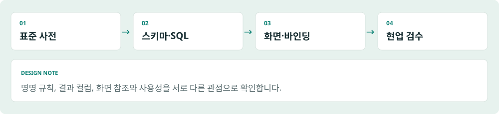

*합성 데이터로 재구성한 설명용 예시 · 실제 운영 화면이 아닙니다.*

### 업무 규칙과 데이터 정합성
계약의 활성·삭제 상태가 사업기회 진행상태와 선택 목록에 함께 반영되도록 보완했습니다. 수주 실적 집계에서는 삭제 계약의 제외 여부와 O&M 포함 기준을 확인했습니다. 계약과 프로젝트의 참조 관계를 점검하고, 업무 판단이 필요한 누락·불일치는 보완 대상으로 정리했습니다.
### 조회·저장·화면을 연결한 검증
공유 SQL의 변경이 여러 보고서에 미치는 영향을 확인하고 결과 컬럼과 화면 바인딩, 조회·저장 동작을 함께 점검했습니다. 작업 기록에는 수주 집계의 기간별 대조와 계약 상태 전이 검증이 남아 있습니다. 자동 점검 이후 본인과 현업의 사용성 검수로 개선했습니다.
### 반복 개발과 데이터 표준 관리
Python 기반 화면 생성, SQL 추출·점검, 바인딩 확인, 표준 사전 조회, 명명 규칙 검사와 DDL 생성 도구를 구현·활용했습니다. 표준단어·용어·도메인과 스키마를 관리해 업무 기능을 추가할 때 반복되는 작업을 줄이는 기반으로 사용했습니다.
### 검증과 효과의 경계
기능 수정과 검증 기록은 구현 근거입니다. 이번 포트폴리오 편집에서 운영 DB를 재검증하지 않았으며, 개발속도 배수·오류 감소율·모든 도메인 규칙의 자동 검증을 주장하지 않습니다.

## 16. 공고를 모으고 원문 근거로 좁히기

**P04 / DISCOVERY** · 여러 공공 공고원의 데이터를 모아 후보와 원문을 함께 확인하도록 구성했습니다.

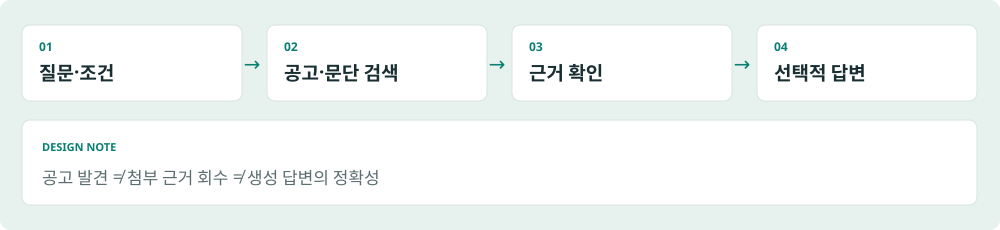

*합성 데이터로 재구성한 설명용 예시 · 실제 운영 화면이 아닙니다.*

### 사용자와 문제
공고가 여러 출처에 흩어져 있으면 관련 후보를 찾고 변경·취소 여부를 다시 확인해야 합니다. 사용자는 정부 공고를 집계하고 직접 후보와 간접 후보를 구분하는 서비스를 설명했습니다.
### 구현한 기반
Python·SQLite 기반으로 공식 API와 게시판 수집, 원문과 정규화 데이터 분리, 후보 분류와 중복 방지, 변경·취소 처리, 재시도·체크포인트가 확인되었습니다. CSV·XLSX 내보내기와 AUD 화면 연결 구조도 있습니다.
### 후보 선별의 의미
직접 후보, 간접 후보, 광범위 후보는 탐색의 범위를 좁히는 분류입니다. 규칙에 따른 후보 분류를 LLM의 사업 판단과 같은 것으로 표현하지 않습니다. 최종 관련성은 원문과 실제 사업 조건을 확인해야 합니다.
### 상태와 한계
기본 집계·탐색 구현은 확인했으나 현업 도입일과 사용 범위는 확인되지 않았습니다. 탐색시간 절감이나 수주 증가를 성과로 수치화하지 않습니다. AI 자연어 검색과 RAG 실험은 별도 개발·실험 단계입니다.

## 17. 질문을 검색 조건으로, 근거를 답변으로

**P04 / AI SEARCH** · 검색 조건 변환, 문단 검색, 선택적 답변 생성을 별도 단계로 구현했습니다.

*합성 데이터로 재구성한 설명용 예시 · 실제 운영 화면이 아닙니다.*

### 자연어 검색
질문을 주제와 필터 등 구조화된 검색 조건으로 바꾸고, 키워드와 임베딩 기반 결과를 조합하는 구현이 있습니다. 이 경로의 핵심은 검색 조건을 만드는 것이며 임의의 SQL이나 최종 사업 판단을 생성한다고 설명하지 않습니다.
### 로컬 RAG 실험
FastEmbed/ONNX 기반 로컬 임베딩으로 공고·첨부 문단을 검색하고 키워드·벡터·혼합 검색을 비교하는 별도 실험이 있습니다. 근거를 이용한 선택적 답변 생성과 인용 검사가 구현되어 있습니다.
### 단계별 품질의 차이
관련 공고를 찾는 것, 필요한 첨부 구절을 찾는 것, 그 근거로 정확한 답변을 만드는 것은 서로 다른 과제입니다. 인용이 존재한다는 검사만으로 답변의 의미적 정확성을 보장할 수 없습니다.
### 현재 상태
사용자 확인 기준 개발·실험 중이며 현업 사용 전입니다. 문서의 연결·배포 기록을 운영 생산성 개선으로 해석하지 않습니다. 향후 OJT·자산관리 RAG 계획과도 구분합니다.

## 18. 공고 발견과 근거 회수를 따로 평가

**P04 / EVALUATION** · 잘 찾은 공고가 곧 답할 수 있는 근거를 뜻하지는 않습니다.

### 문서에 기록된 평가
검색 평가 문서는 정답 공고를 상위 결과에서 찾았는지와 필요한 첨부 구절을 찾았는지를 별도 대상으로 다뤘습니다. 첨부 근거 회수의 한계가 기록되어 있습니다. 작은 표본의 서로 다른 평가를 합쳐 전체 정확도라는 숫자로 제시하지 않습니다.
### 평가 조건의 제한
일부 자연어 검색 검증은 API 키 없이 이루어져 실제 모델 응답 품질과 전체 벡터 경로를 제외했다고 명시되어 있습니다. 실험 규모와 점수는 문서 기록이며 이번 포트폴리오 제작에서 DB 조회나 재실행으로 확인하지 않았습니다.
### 이 사례가 보여주는 판단
생성 모델을 붙였다는 사실보다 어떤 근거를 회수했고 무엇을 검증하지 못했는지 나누어 보는 태도에 의미가 있습니다. 답변 생성 이전에 문단 검색의 한계가 드러나면 평가와 개선도 그 단계부터 필요합니다.
### 다음 개선 방향
업무 질문 표본을 늘리고 공고·첨부 단위 정답을 구분해 관리하는 것이 후속 방향입니다. 인용의 존재, 실제 근거와의 일치, 조건 해석의 정확성은 각각 확인해야 합니다. 아직 완료한 검증이나 현업 성과로 쓰지 않습니다.

## 19. 청구서의 도착과 처리를 보이게

**P05 / VISIBILITY** · 담당자의 기억에 의존하던 확인을 업무 화면의 상태로 바꿨습니다.

### 문제
전기료·통신비 청구서를 받았는지, 후속 처리를 했는지 확인하는 부담과 누락 가능성이 있었습니다. 사용자는 과거 추가 비용 발생을 언급했지만 정확한 비용 성격과 건수·원인은 확인되지 않았습니다.
### 본인의 기여
청구서를 수신하면 업무시스템에서 목록과 처리 상태를 확인하도록 연결했습니다. 메일 분석 결과를 청구·발전소별 기록으로 남기는 구현과 수신·전표 현황, 수동 확인에 관한 문서가 있습니다.
### 중요한 선택과 변화
담당자가 확인해야 할 대상을 업무 화면에 드러내 누락을 발견할 수 있도록 했습니다. 이메일 도착과 업무 처리가 같은 상태가 아님을 구분하는 가시성 개선입니다. 자동 분개·전표 발행·납부까지 완료했다는 설명은 하지 않습니다.
### 결과와 다음 확인
기능 구현과 사용자 설명을 근거로 청구 수신·처리 상태를 연결한 사례로 제시합니다. 현업 도입 범위와 실제 미처리 발견 사례, 도입 전후 누락률은 추가 확인 대상입니다. 절감액이나 추가 비용 발생 0건 같은 수치는 사용하지 않습니다.

## 20. 홈페이지의 목적부터 내부 합의까지

**P07 / ALIGNMENT** · 화면 구현뿐 아니라 독자·메시지·정보 구조를 정리했습니다.

### 배경과 제안
예정된 홈페이지 외주 견적을 보고 내부 제작을 제안했고, AI 도구 사용 비용을 지원받기로 했습니다. 견적을 실제 절감액으로 단정할 수 없으므로 비용 성과 대신 제안과 제작 책임에 초점을 둡니다.
### 본인이 맡은 일
프론트엔드·백엔드 구현과 함께 대상 사용자 설정, 스토리라인, 히어로 메시지, 정보 구조를 정리했습니다. 내부 의견을 수렴하고 결정을 촉진하는 과정도 주도했다고 설명했습니다.
### 기술 외의 문제 해결
의견이 모였다는 사실만으로 구현 방향이 정해지지는 않습니다. 누구에게 무엇을 보여줄 것인지 정리하고 합의를 산출물로 연결하는 일이 필요했습니다. 이 사례는 정해진 화면 명세를 구현하는 역할을 넘어선 경험입니다.
### 상태와 근거
현재 개발·내부 검토 중이라는 사용자 확인을 따릅니다. 소스는 별도 로컬 환경에 있어 이번 검토에서 열람하지 못했습니다. 공개·납품 완료, 실제 비용 절감과 방문자 성과는 주장하지 않습니다. 예정 회사 도메인을 개인 포트폴리오 주소로 사용하지 않습니다.

## 21. 낯선 영상 과제를 제작 흐름으로

**P08 / ADAPTATION** · 도구를 시험하고 통제하기 어려운 단계를 다른 방식으로 바꿨습니다.

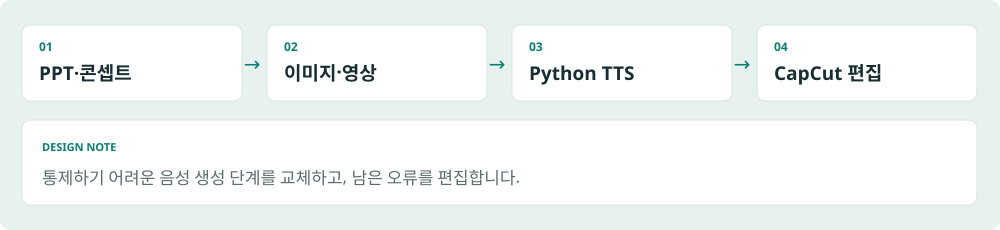

*합성 데이터로 재구성한 설명용 예시 · 실제 운영 화면이 아닙니다.*

### 요청과 제약
태양광 발전·인허가 절차를 설명하는 PPT를 영상으로 전환하는 과제를 맡았습니다. 영상 제작 경험이 없는 상태였고, 여러 유료 플랜을 모두 사용할 수 없어 무료 범위에서 적합성을 시험했습니다.
### 제작 과정
ChatGPT·Gemini로 제작 방법을 탐색하고, ChatGPT로 콘셉트 이미지를 만들고, Gemini로 영상을 생성한 뒤 CapCut으로 편집했습니다. 산출물의 목적에 맞춰 도구를 이어 붙이는 과정이었습니다.
### 막힌 단계의 전환
Gemini 음성 생성에서 통제하기 어려운 오류가 발생해 Python TTS 라이브러리로 음성을 생성하는 방식으로 바꿨습니다. 남은 오류는 CapCut에서 수정했습니다. 자체 음성 모델이나 영상 AI 모델을 개발한 경험으로 표현하지 않습니다.
### 결과와 한계
낯선 과제에서 제작 방법을 학습하고 문제가 있는 단계를 교체한 실행 사례입니다. 구체적인 TTS 라이브러리, 영상 길이, 납품 여부와 반응은 확인되지 않았습니다. 원본 PPT·영상 대신 새로 작성한 제작 흐름을 제공합니다.

## 22. AI가 하는 일과 사람이 책임질 일

**AI PRACTICE** · 개발 보조, 시스템 내부 기능, 콘텐츠 제작, 미래 계획을 나누어 설명합니다.

| 활용 구분 | 실제 사례 | 확인·검토의 경계 |
|---|---|---|
| 개발 보조 | Gemini, Cursor, ChatGPT, Claude로 구현·점검 지원 | 최종 결과는 본인·현업 검수 |
| 업무 기능 | 메일의 선택적 AI 분류 보완 | 규칙 우선, 모든 메일 AI 처리 아님 |
| 검색 실험 | 질문 구조화, 임베딩 검색, 선택적 근거 기반 생성 | 현업 사용 전, 검색·생성 평가 구분 |
| 콘텐츠 제작 | 이미지·영상·TTS·편집 | 모델 개발이 아닌 제작 도구 활용 |
| 향후 계획 | OJT·자산관리 RAG | 미착수 계획 |

### 사람의 역할
업무 요구를 이해하고 구현 범위를 결정하는 책임, 최종 결과를 확인하는 책임을 AI 사용과 함께 설명합니다. 기술 점검과 사용자 검수의 질문이 다르다는 점을 유지합니다.
### 과장하지 않는 기술 설명
크롤링·규칙 분류·계산·스케줄링은 그 자체로 AI 기능이 아닙니다. 반대로 실제 AI 경로가 있는 메일 보완과 검색 실험은 단순한 개발 보조와 구분합니다. 이 포트폴리오는 모델 연구보다 업무 문제 정의와 시스템 통합에 무게를 둡니다.

## 23. 기술은 사례와 함께 증명합니다

**CAPABILITIES** · 나열한 기술마다 실제로 연결된 업무와 확인 범위를 제시합니다.

| 역량 | 연결된 기술·업무 | 사례 |
|---|---|---|
| 데이터 수집·통합 | Python, requests, BeautifulSoup, Selenium/CDP, JSON·HTML | P01, P04 |
| 서비스·API | FastAPI, Pydantic, httpx, Node/JavaScript | P01, P03 |
| 데이터 저장·처리 | PostgreSQL, SQLite, pandas, SQLAlchemy | P01–P04 |
| 업무 메시지·파일 | SMTP/POP3, Excel·PDF 처리, 파일 워처, 검토 상태 | P02, P05 |
| 공간·재무 정보 연결 | Shapely, pyproj, 외부 데이터, 현금흐름·IRR·NPV·DSCR 구현 | P03 |
| 개발 기반·데이터 표준 | Python 도구, SQL·바인딩·명명 검사, 표준 사전 | P06 |
| AI 검색·실험 | 질문 구조화, 임베딩, FastEmbed/ONNX, 근거 검색·인용 검사 | P04 |
| 요구 구체화·협업 | 현업 학습, 정보 구조, 내부 의견 조율, 피드백 반영 | P03, P07 |

### 기술 선택을 읽는 기준
도구의 존재보다 업무 흐름에서 맡은 역할을 설명합니다. 확인한 소스·의존성과 사용자 기여 설명을 연결하되, 라이브러리 사용을 그 제품 자체의 개발 경험으로 바꾸지 않습니다. 숙련도 점수나 검증되지 않은 등급은 사용하지 않습니다.

## 24. 측정과 업무 자산화로 이어갑니다

**NEXT** · 이미 구현한 흐름의 효과를 확인하고, 축적한 업무 지식을 다음 과제로 연결합니다.

### 우선할 개선
관제는 갱신·판정·알림 지연을 나누어 측정하고, 실적 자동화는 대상 월간 업무와 유지보수 시간을 구분해 기록하는 것이 후속 과제입니다. pre-fs는 실제 현업 표본과 도입 범위를 확인해야 합니다. 공고 검색은 첨부 근거 회수와 생성 답변 평가를 구분해 개선합니다.
### 업무 자산화와 계획
P06의 주간회의 작성·버전·확정 및 AUDPlatform 연동 경험은 업무 지식을 문서로 축적하는 기반입니다. 실제 도입 효과는 확인되지 않았습니다. 향후 축적한 프로세스·문서·데이터를 바탕으로 OJT와 자산관리 RAG를 검토하려 합니다. 이 RAG는 미착수 계획입니다.
### AX에서 기여할 수 있는 일
반복 업무와 현업 병목을 파악하고 자동화할 범위와 사람이 검토할 범위를 정리하겠습니다. 실적 자동화, O&M 관제, 개발·데이터 표준 기반과 검색 실험이 관련 경험입니다.
### FDE에서 기여할 수 있는 일
불명확한 요구를 사용자와 구체화하고, 외부 데이터와 기존 업무 시스템의 제약 속에서 구현·검증을 연결하겠습니다. O&M 관제, pre-fs, 실적 연동이 이를 보여줍니다.
### 마무리
필요한 업무를 배우고, 사람과 기술을 연결하고, 결과를 직접 확인하는 방식으로 일합니다. 더 많은 기능보다 실제로 쓰이며 설명 가능한 결과를 만들고자 합니다.

---

김민기 · Kim Mingi · 2026.09 · 일반화한 경험 서술과 합성 도식으로 구성했습니다.

[PDF](../exports/portfolio.ko.full.pdf) · [PPTX](../exports/portfolio.ko.full.pptx) · [DOCX](../exports/portfolio.ko.full.docx) · [Web](../web/ko.full.html)

[GitHub](https://github.com/laekhole)
